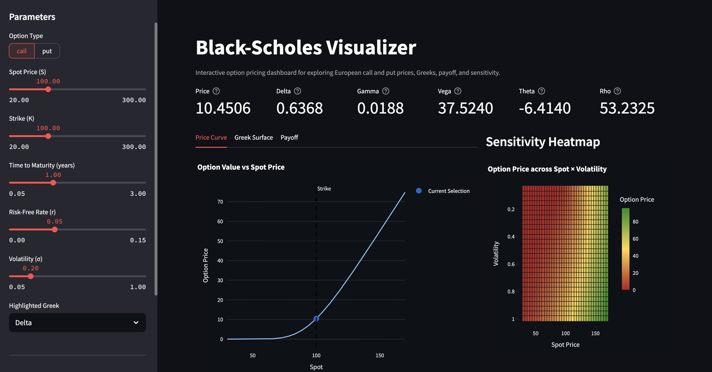

# Black-Scholes Visualizer

This project is an interactive Streamlit dashboard for exploring European option pricing under the Black-Scholes model. Instead of just computing a single option price, the app visualizes how option value and sensitivities change as you adjust inputs like spot price, strike, volatility, time to maturity, and interest rates. The goal was to make the model more intuitive by turning the math into something you can actually see and interact with.

## Features
- Adjustable parameters for spot, strike, time to maturity, rate, volatility, and option type
- Dashboard-style metric cards for price, Delta, Gamma, Vega, Theta, and Rho
- Interactive charts for price curves, Greek exposure, and expiration payoff
- Heatmap showing option price across spot–volatility scenarios
- Modular structure separating pricing logic, analytics, and UI

## Tech Stack
- Python
- NumPy
- Pandas
- Plotly
- Streamlit
- Pytest

## Project Structure
black_scholes_visualizer/
├── app.py
├── README.md
├── requirements.txt
├── src/
│   └── black_scholes/
│       ├── __init__.py
│       ├── analytics.py
│       └── core.py
└── tests/
    ├── test_analytics.py
    └── test_core.py

## Why I Built This
I built this project to better understand how option prices and Greeks behave across different scenarios, not just at a single point. Most explanations of Black-Scholes focus on the formula, but in practice what matters is how price and sensitivities change when volatility, time, or the underlying price changes. This dashboard was designed to make those relationships visual and interactive instead of purely theoretical.